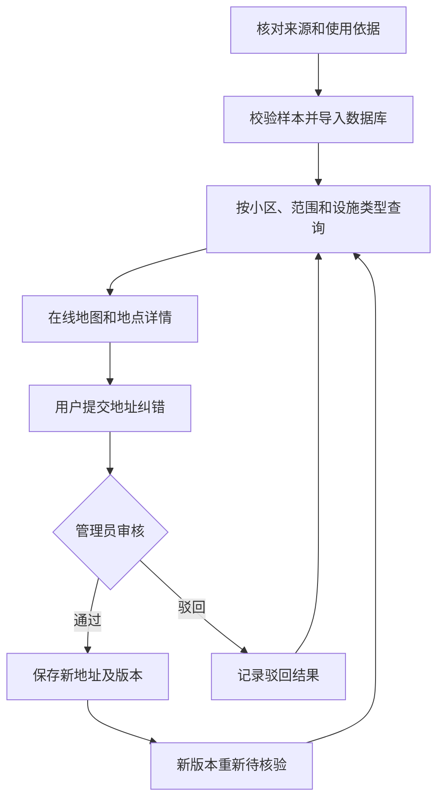
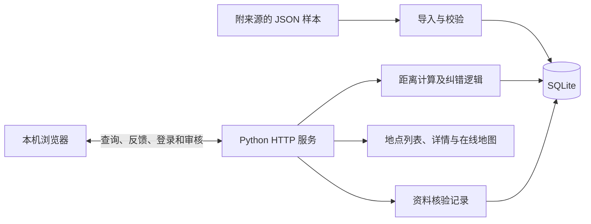

# 邻境 · 初赛设计说明草稿

赛题四：银行与小区信息采集及查询系统。试点范围为 OSM 学校面历史参考点 `114.210700, 22.687940`（WGS84）周边 3 公里；此点不是校门。本文记录当前可复现的本机原型与后续工作。

## 需求与场景

用户从小区出发，按直线范围查看附近银行或 ATM，核对地址和信息来源。发现地址有误时提交建议，管理员核实后更新记录。系统保留原地址、新地址及审核状态。试点样本为六个小区、两家银行网点和一台 ATM，共九条。小区坐标为区域代表点，黄阁翠苑例外使用同名公交站参考点；设施点采用校区区域或楼宇代表点，准确入口和当前开放情况待核实。

银行卡片可反向列出该网点 3 公里内的已入库小区，并跳回小区周边查询；两向使用同一距离计算。ATM 暂不显示此入口。

## 业务闭环

提交后只出现待审核记录。通过时，纠错状态和地点修改在同一数据库事务中保存。反馈基于旧版本时不允许覆盖后来已经生效的修订。

## 当前架构

- `import_places.py` 检查来源链接、坐标格式和 3 公里试点范围。相同来源编号内容不变时跳过；字段变化时增量更新。
- `collection_jobs.py` 支持手动上传或程序运行期间定时读取本机 JSON，先生成待审核候选。管理员核对来源许可、地点类别与坐标后入库；变化字段升版本并记录 `place_changes`，已审核通过的地址不被来源更新覆盖。任务记录待采集、执行中、成功、失败及原因；失败的本机文件任务可重试。程序关闭期间不执行，重启后过期任务只运行一次。
- `linjing_db.py` 实现球面直线距离、纠错和审核事务。
- `demo_web.py` 渲染查询与审核页面。服务只监听本机，管理员使用本次启动的临时口令。
- `live_map.py` 加载高德在线地图，样本 WGS84 坐标只在显示时转为 GCJ-02；地图和筛选列表同步。高德实时搜索结果只在当前页面临时展示，不写入试点库。安全密钥保存在本机忽略的配置文件，浏览器使用公开的 JS API Key。
- 管理员可为当前地点版本记录资料核验依据；审核纠错后旧核验不自动适用于新版本。公开资料核对不代表网点营业或 ATM 可用。
- `probe_amap.py` 用于接口和字段可得性验证。公开样本单独说明来源；临时查询的原始地点坐标未入库。

## 核心接口

| 方法与地址 | 主要输入 | 结果 |
| --- | --- | --- |
| GET `/` | 小区编号、半径、设施类型 | 返回匹配列表和同一组标记，按距离排序 |
| POST `/correction` | 地点编号、建议地址、依据、表单令牌 | 生成待审核记录；相同地址会被拒绝 |
| POST `/login` | 本次启动的口令、表单令牌 | 成功后进入本机管理员模式 |
| POST `/review` | 纠错编号、通过或驳回、表单令牌 | 检查管理员身份；通过时更新地址和版本 |
| POST /logout | 表单令牌 | 结束当前管理员会话 |
| POST /import | 管理员会话、表单令牌、地点 JSON | 校验范围和来源字段，生成待审核候选，不直接入库 |
| POST /candidate | 候选编号、许可确认、通过或驳回 | 管理员确认后增量入库或驳回 |
| POST /retry | 失败的本机文件任务编号 | 保留失败原因，可重试读取 |
| POST /verify | 管理员会话、地点编号、核验结果、证据链接和说明 | 保存当前版本的资料核验记录 |

## 关键数据表

| 表 | 用途 | 关键字段 |
| --- | --- | --- |
| `places` | 保存当前地点 | 编号、类型、名称、地址、坐标、来源、版本、更新时间 |
| `corrections` | 保存建议和审核轨迹 | 地点编号、提交时版本、旧地址、建议地址、依据、状态、提交与审核时间 |
| `place_imports` | 记录样本来源和导入过程 | 来源链接与编号、使用依据、坐标系、学校参考点、导入时间 |
| `place_verifications` | 保存地点版本对应的资料核验 | 地点编号、版本、结果、证据链接、说明、记录时间 |
| `query_interests` | 累计各小区查询请求，供管理员安排资料核对顺序 | 小区编号、查询次数、最近查询时间；不保存访问者身份 |
| `collection_jobs` | 记录本机文件或上传任务 | 状态、开始和结束时间、候选数、失败原因、下次运行时间 |
| `collection_candidates` | 审核前暂存来源行 | 来源编号、候选 JSON、待审/通过/驳回状态 |
| `place_changes` | 增量更新审计 | 前后版本、来源、变化字段、采集时间 |

## 复现与验证

Windows 中运行 `打开真实地点查询.cmd`。也可运行 `python run_pilot.py` 自动准备数据库并启动页面。程序会打印本机访问地址。

| 验证场景 | 已核验结果 |
| --- | --- |
| 查询筛选 | 龙城支行建筑参考点距学校参考点约 2,097 米，距嘉欣园约 2,321 米。独立临时数据库验证：已入库小区的 3 公里查询可返回设施样本；具体数量随小区位置变化。 |
| 查询统计 | 统计条仅计算当前小区、范围与类型筛选后的已入库设施。临时数据库检查全部、银行、ATM、空结果，数量与列表一致；不代表区域总量。 |
| 更新优先级 | 管理员队列按“查询请求次数×2＋周边待资料核对设施数”排序；临时数据库验证查询增加会改变顺序。刷新同一查询网址也会计数，不代表独立用户数。 |
| 反向关联 | 两家银行网点可列出 3 公里内符合范围的已入库小区；与小区到银行查询的距离一致。 |
| 图与详情 | 在线地图和列表使用同一批查询结果，标记与卡片可互相定位；地点详情保留来源。[实际浏览器截图](验证证据/05-在线地图与筛选.png)同屏显示筛选、统计、标记、图例和三张卡片。 |
| 本机采集与增量 | `verify_collection.py` 在临时目录验证运行期定时触发、候选不直接入库、审核、变更升版、人工地址保护、失败原因及重试；模拟来源变化不代表外部 API 许可。 |
| 提交及审核 | 待审核时保留旧地址，访客无法审核。管理员通过后地址和版本更新。 |
| 重启和重新导入 | 用测试数据库验证了重启仍保留修订，重复导入不覆盖审核结果。 |
| 干净目录复现 | 九条样本在独立临时数据库首导新增 9 条、重复导入新增 0 条；网页输出含新网点、3 张设施卡及位置提示。独立服务器仍待验证。 |
| 完整流程复现 | `verify_clean_launch.py` 把源码复制到自动清理的临时目录，验证首次导入、网页查询、待审核不改址、管理员审核更新及重启后保存；未使用本机试玩数据库和地图密钥。 |
| 外部接口 | 首次真实验证中，银行与小区各返回第一页 10 条。详见[验证统计](验证证据/首次接口验证_20261106.md)。 |
| 核验记录 | 独立临时数据库验证：管理员保存后可显示，访客不能写入；地址版本更新后恢复未核验。 |

实际样本和来源见[样本说明](../samples/README.md)。

## 可行性与初赛安排

- 技术：本机原型使用 Python 标准库及 SQLite，核心查询和审核已经验证。难点是独立服务器尚未验证；先用干净目录复现，决赛前准备部署脚本并在指定纯净服务器实测。地图不可用时保留列表和离线示意图。
- 数据：现有 9 条样本仍不能代表区域完整覆盖。黄阁翠苑位置为同名公交站参考点；来源不明的字段不补填，房价参考值不能作为实时均价。逐条核对来源与位置；高德候选在未确认持久化许可时只临时展示，未知营业状态保持未核验。
- 时间：11 月 13 日前完成原型与证据；14—17 日回归、资料核对和文档完善；18—19 日冻结初赛版本并检查评审访问。如扩充数据来不及，保留可复现的 9 条试点样本和覆盖边界，不用假数据填数。
- 已有本机 JSON 手动候选和运行期定时读取、增量入库及失败重试；独立服务器调度、获许可的外部接口持久化采集、框选、图层切换、热度驱动频率调整及更多字段仍待实现。查询热度目前只影响人工复核排序。

## 数据许可与边界

现有九条为 OSM 代表点试点样本，仅用于原型流程验证，不作为已核实的正式地图数据源。原始采集时间未核实；OSM 数据及衍生数据库遵守 ODbL 署名及许可要求。高德搜索仅临时展示，不入库。数据来源、许可及 3 公里参考点的逐项限制见[数据许可与参考点](数据许可与参考点.md)。

## AI 服务使用说明

开发中使用 OpenAI Codex / ChatGPT 对话服务辅助起草代码、整理文档与排查问题，参赛者负责最终核对。调用方式为在客户端对话；邻境程序运行时未集成 AI 服务，也不调用模型 API，因此没有产品内集成位置。AI 生成内容不作为地点真实性或人工核验结论。
