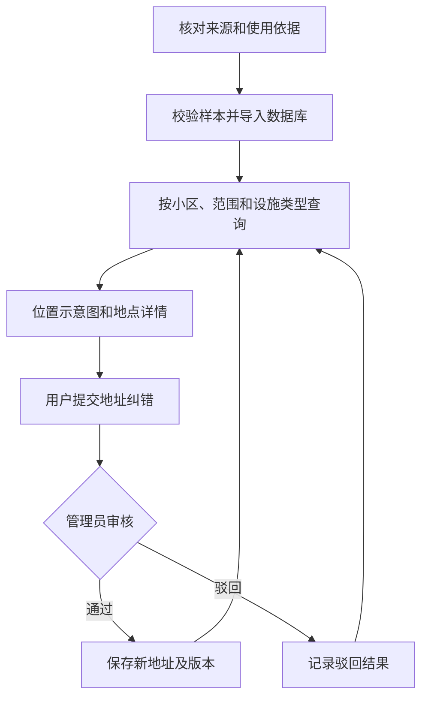
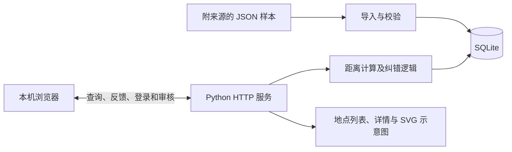

# 邻境 · 初赛设计说明草稿

赛题四：银行与小区信息采集及查询系统。试点范围为深圳信息职业技术大学周边约 3 公里。本文记录当前可复现的本机原型与后续工作，正式版需按初赛要求导出并复核页数。

## 需求与场景

用户从小区出发，按直线范围查看附近银行或 ATM，核对地址和信息来源。发现地址有误时提交建议，管理员核实后更新记录。系统保留原地址、新地址及审核状态。原型用嘉欣园、中信银行深圳港中大支行和中国银行上园 ATM 演示。设施距离采用校区区域代表点，设备入口和当前开放情况待核实。

## 业务闭环

提交后只出现待审核记录。通过时，纠错状态和地点修改在同一数据库事务中保存。反馈基于旧版本时不允许覆盖后来已经生效的修订。

## 当前架构

- `import_places.py` 检查来源链接、坐标格式和 3 公里试点范围。相同来源编号再次导入会跳过。
- `linjing_db.py` 实现球面直线距离、纠错和审核事务。
- `demo_web.py` 渲染查询与审核页面。服务只监听本机，管理员使用本次启动的临时口令。
- `probe_amap.py` 用于接口和字段可得性验证。公开样本单独说明来源；临时查询的原始地点坐标未入库。

## 核心接口

| 方法与地址 | 主要输入 | 结果 |
| --- | --- | --- |
| GET `/` | 小区编号、半径、设施类型 | 返回匹配列表和同一组标记，按距离排序 |
| POST `/correction` | 地点编号、建议地址、依据、表单令牌 | 生成待审核记录；相同地址会被拒绝 |
| POST `/login` | 本次启动的口令、表单令牌 | 成功后进入本机管理员模式 |
| POST `/review` | 纠错编号、通过或驳回、表单令牌 | 检查管理员身份；通过时更新地址和版本 |
| POST `/logout` | 表单令牌 | 结束当前管理员会话 |

## 关键数据表

| 表 | 用途 | 关键字段 |
| --- | --- | --- |
| `places` | 保存当前地点 | 编号、类型、名称、地址、坐标、来源、版本、更新时间 |
| `corrections` | 保存建议和审核轨迹 | 地点编号、提交时版本、旧地址、建议地址、依据、状态、提交与审核时间 |
| `place_imports` | 记录样本来源和导入过程 | 来源链接与编号、使用依据、坐标系、学校参考点、导入时间 |

## 复现与验证

Windows 中运行 `打开真实地点查询.cmd`。也可在项目目录创建 `data` 文件夹，依次运行 `python import_places.py samples/pilot_osm.json --db data/pilot.sqlite` 和 `python demo_web.py --pilot-db data/pilot.sqlite --open-browser`。程序会打印本机访问地址。

| 验证场景 | 已核验结果 |
| --- | --- |
| 查询筛选 | 嘉欣园、3,000 米时，银行和 ATM 可分别筛出。缩到 1,000 米时，两条样本均被排除。 |
| 图与详情 | 图和列表使用同一批查询结果；编号链接对应地点详情，详情有来源链接。 |
| 提交及审核 | 待审核时保留旧地址，访客无法审核。管理员通过后地址和版本更新。 |
| 重启和重新导入 | 用测试数据库验证了重启仍保留修订，重复导入不覆盖审核结果。 |
| 外部接口 | 首次真实验证中，银行与小区各返回第一页 10 条。详见[验证统计](验证证据/首次接口验证_20261106.md)。 |

实际样本和来源见[样本说明](../samples/README.md)。

## 可行性与初赛安排

- 技术：本机原型使用 Python 标准库及 SQLite，核心查询和审核已经验证。正式部署需在干净环境重新验证。
- 数据：样本量仅足以验证流程。来源不明的字段不补填，房价参考值不能作为实时均价。后续补充可用来源和数据覆盖。
- 11 月 9—13 日拟完善试点数据、手动更新与运行说明；14—17 日拟做回归、部署复现和证据整理；18—19 日拟冻结初赛版本、导出文档并核对评审访问。
- 目前的位置示意图不含道路底图，完整地图交互、批量定时采集、热度驱动刷新及更多字段仍待实现。
